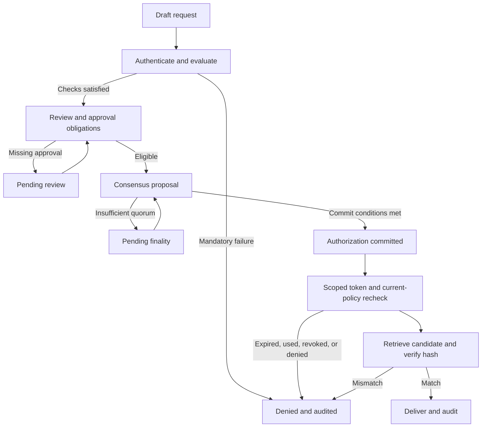
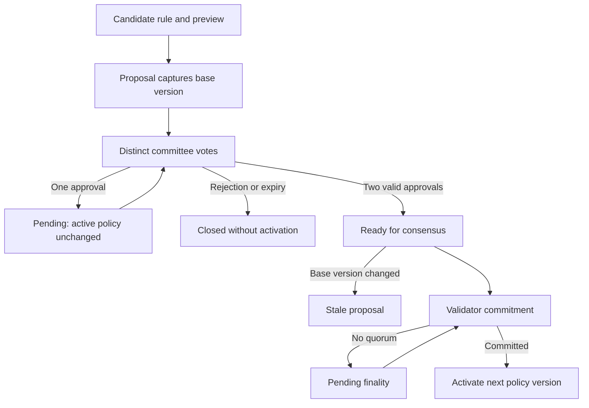
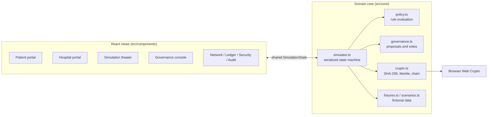

# MediChain — Blockchain Healthcare Governance Simulator

An interactive, blockchain-inspired healthcare governance simulator featuring patient and hospital portals, consent workflows, and policy-based access control.

**🌐 Live demo:** [medichain.xauzitwork.com](https://medichain.xauzitwork.com/)
**📦 Repository:** [github.com/XauZit/medichain-governance](https://github.com/XauZit/medichain-governance)


> [!IMPORTANT]
> **Educational Blockchain Simulation — No Real Network.** MediChain runs entirely in your browser. There is no blockchain node, wallet, RPC, deployed smart contract, backend server, or real healthcare integration. All people, hospitals, records, identities, and credentials are fictional. It is **not** a production healthcare system and must not be used with real patient data.

---

## Table of contents

- [Overview](#overview)
- [Educational objectives](#educational-objectives)
- [Key features](#key-features)
- [Patient and Hospital portals](#patient-and-hospital-portals)
- [Governance and access-control workflow](#governance-and-access-control-workflow)
- [How the blockchain-inspired simulation works](#how-the-blockchain-inspired-simulation-works)
- [Technology stack](#technology-stack)
- [System architecture](#system-architecture)
- [Getting started](#getting-started)
- [First classroom run](#first-classroom-run)
- [The dynamic-governance demonstration](#the-dynamic-governance-demonstration)
- [Fifteen scenario presets](#fifteen-scenario-presets)
- [Project structure](#project-structure)
- [What is actually enforced](#what-is-actually-enforced)
- [Testing and verification](#testing-and-verification)
- [Security and privacy considerations](#security-and-privacy-considerations)
- [Simulation boundary](#simulation-boundary)
- [Academic grounding](#academic-grounding)
- [Classroom presentation guide](#classroom-presentation-guide)
- [Documentation](#documentation)
- [Disclaimer](#disclaimer)
- [Author](#author)

---

## Overview

MediChain is a browser-local educational application built for Assignment 1 of *Blockchain & Applications*. It demonstrates how a consortium of hospitals could govern access to medical history using identity evidence, executable policy rules, committee-approved policy changes, validator consensus, hash-linked ledgers, and integrity checks.

The Patient and Hospital portals share **one deterministic state machine**. Typed governance rules produce real `PERMIT`, `DENY`, pending-approval, and pending-finality outcomes — the interface displays calculated results rather than scripted success messages. SHA-256 hashing (via the browser's Web Crypto API), Merkle proofs, hash-chain verification, quorum counting, and policy evaluation are actually computed; the distributed network, identities, and signatures are explicitly modeled.

## Educational objectives

MediChain is designed to help students and instructors:

1. **Separate identity from authorization** — DID registration, credential validity, record ownership, RBAC, and ABAC are distinct checks with distinct failure reasons.
2. **See governance as executable rules** — operational policy is versioned, changed only through a justified proposal, two distinct committee approvals, and validator commitment.
3. **Distinguish decision stages** — eligibility, approval obligations, ledger finality, and record release are separate gates; a favorable early result does not expose a record.
4. **Understand tamper evidence** — compare real SHA-256 digests, verify Merkle inclusion proofs, and detect broken hash chains.
5. **Reason about consensus** — explore a simplified four-validator PBFT model (`n = 4`, `f = 1`, quorum `2f + 1 = 3`) with offline and faulty nodes.
6. **Keep clinical data off-chain** — the ledger stores metadata and hashes, never patient names, diagnoses, or report contents.
7. **Recognize the limits of the model** — every simulated component is labeled, and production gaps are documented.

## Key features

Every feature below is implemented in the source code and covered by the automated test suite.

| Area | Working behavior |
| --- | --- |
| Simulation theater | Three synchronized regions; 23 inspectable stages; meaningful denial and pending branches; manual and automatic playback; historical replay; trace export; classroom/fullscreen mode. |
| Patient portal | DID/assurance evidence, category/date filters, record selection, queue status, denied reasons, released-record view and printable report, consent and audit access. |
| Hospital portal | Dashboard, three-patient registry, ten-record vault across two hospitals, shared queue, resume individual requests, verification workstation, constrained approval/rejection. |
| Governance | Eight structured operational rules, immutable security invariants, computed previews, justified versioned proposals, three committee actors, 2-of-3 voting, rejection/expiry/stale vote protections, phased activation. |
| Clinician consent | Scoped categories, purpose and expiry, explicit revocation, clinician request form, on-shift and relationship attributes. |
| Consensus | Four configurable hospital validators, offline/faulty experiments, explicit pre-prepare/prepare/commit/finality phases, matching message trace, quorum 3. |
| Ledger and integrity | Canonical SHA-256 block hashes, transaction Merkle roots, four-report anchored Merkle proofs, isolated record tampering and block-copy experiments, hash-chain verification. |
| Capabilities | Exact subject/scope/committed-authority binding, expiry, single-use nonce, policy and consent rechecks, deterministic clock, replay experiment. |
| Teaching | Five clickable architecture layers, nine presentation chapters, ordinary and technical step explanations, reference mapping, comprehensive instructor script and likely questions. |

The application has twelve pages grouped into three navigation sections:

- **Workspace** — Simulation theater, Hospital dashboard, Medical records, Request queue, Patient consent, Governance console
- **Blockchain lab** — Validator network, Ledger & integrity, Security center, Audit explorer
- **Learn & present** — Demo scenarios, Architecture & guide

## Patient and Hospital portals

Both portals are views of the same shared `SimulationState`, so an action in one is immediately visible in the other. Switching portals is an actor-view switch for demonstration purposes — it is not a login.

### Patient portal

The patient workspace represents **Ayesha Ahmed** (fictional patient `P001`). The patient can:

- Review their demonstration identity evidence: DID, credential issuer, validity, and identity-assurance level (Level 1–3).
- Browse their medical history with category and date filters, and select the exact records to request.
- Submit an access request and follow its status through the shared hospital queue.
- See the precise rule that caused a denial, including the actual and required values.
- Open approved records after verified release and download a fictional report as printable HTML.
- Manage clinician consent and review their audit trail.

### Hospital portal

The hospital workspace represents the records office at **Crescent General Hospital**. The operator can:

- View a dashboard with a three-patient registry and a ten-record vault spread across two hospitals.
- Work through the shared request queue and resume individual requests independently.
- Inspect each verification check (authentication, DID, credential, ownership, RBAC, ABAC, consent) in the verification workstation.
- Approve or reject requests as the Records Officer — approval completes an obligation but **cannot override a failed mandatory check**.

## Governance and access-control workflow

### Access requests

Access decisions use **deny-overrides**: any failing mandatory rule denies the request; if nothing denies but an obligation is outstanding, the request is pending; otherwise it is eligible.



**Mandatory checks** (cannot be disabled by governance): `AUTH-001` authentication, `DID-001` registered identity, `CRED-001` credential validity, `OWN-001` record ownership, `RBAC-001` processing role, and `INTEGRITY-001` content hash.

**Operational settings** (changeable only through governance): minimum identity assurance, hospital manual review, sensitive-record approval threshold, clinician consent, clinician on-shift requirement, treatment relationship, cross-hospital release, and capability-token lifetime.

### Policy changes



The governance committee is the **CMIO**, **Privacy Officer**, and **Compliance Officer**. A proposal needs two distinct approvals (any rejection closes it), then validator commitment, before a new policy version activates. Previous decisions keep the policy version that was active when they were made, and pending requests are re-evaluated against the current policy before release.

See [docs/policy-rules.md](docs/policy-rules.md) for the complete rule reference.

## How the blockchain-inspired simulation works

| Concept | How MediChain models it |
| --- | --- |
| Consortium network | Four named hospital validators (H1–H4) held as local objects; each can be set online, offline, or faulty. |
| Consensus | A staged, simplified PBFT model: pre-prepare → prepare → commit → finality, requiring 3 matching validators. Missing quorum yields *pending finality* — never a fabricated block. |
| Ledger | Hash-linked blocks with canonical SHA-256 block hashes, previous-hash pointers, and transaction Merkle roots. A genesis block anchors the seeded record hashes. |
| Smart contracts | Typed TypeScript policy functions that evaluate the active, versioned policy. No Solidity or chaincode is deployed. |
| Identity | A demo DID registry and fixture credentials with issuer, expiry, revocation, and assurance level. |
| Signatures | Clearly prefixed `SIM-…` fingerprints computed from public labels — explicitly **not** digital signatures. |
| Off-chain storage | An in-memory "hospital vault" holding fictional clinical content; only hashes and metadata reach the ledger. |
| Capability tokens | Scoped, expiring, single-use tokens bound to a committed authorization, checked against a deterministic simulation clock. |

The simulation clock starts at **5 November 2026, 09:00 UTC** and advances only through explicit actions, so expiry demonstrations are repeatable.

## Technology stack

| Layer | Technology |
| --- | --- |
| Language | TypeScript 5.8 (strict mode) |
| UI framework | React 19 |
| Build tool / dev server | Vite 6 with `@vitejs/plugin-react` |
| Styling | Tailwind CSS 4 (via `@tailwindcss/vite`) with custom design CSS |
| Animation | Framer Motion 12 |
| Icons | Lucide React |
| Cryptography | Browser Web Crypto API (`SubtleCrypto` SHA-256) |
| Testing | Vitest 3 (domain, workflow, and React server-render tests) |
| Runtime | Node.js 22+ (development and build only); the output is static HTML/CSS/JS |

Domain functions are separated from rendering. No arbitrary user code is evaluated.

## System architecture

MediChain is a static single-page application. All state lives in browser memory; there is no backend.



The five teaching layers are:

| Layer | Responsibility |
| --- | --- |
| Application | Patient requests, hospital queue, governance console, teaching controls |
| Governance contract | Structured, versioned TypeScript rules modeling contract behavior |
| Identity | Demo DID registry, credentials, challenge results, assurance evidence |
| Ledger and consensus | Four validators, phase messages, quorum, metadata-only hash-linked blocks |
| Off-chain storage | Fictional clinical records and the approved-report presentation |

Read [docs/architecture.md](docs/architecture.md) for the full typed domain model and state flows.

## Getting started

### Prerequisites

- **Node.js 22 or newer** and **npm** (the project declares `"engines": { "node": ">=22" }`)
- A modern browser with **Web Crypto** and `structuredClone` support
- Works with Windows PowerShell, WSL, macOS, and Linux

### Installation

```powershell
git clone https://github.com/XauZit/medichain-governance.git
cd medichain-governance
npm ci
```

Only the initial dependency install needs package-registry access. The running app makes no external healthcare, blockchain, font, or analytics requests.

### Development server

```powershell
npm run dev -- --port 5173
```

Open **http://localhost:5173/**.

> [!NOTE]
> Use `localhost` or a real HTTPS origin. Web Crypto's SHA-256 API is restricted to secure browser contexts. Opening `index.html` directly, or using an ordinary HTTP LAN hostname/IP, is not a supported way to run the simulator — the app will refuse to initialize rather than fake its hashes.

### Testing, type checking, and production build

```powershell
# Automated domain and workflow tests (Vitest)
npm test

# Watch mode while developing
npm run test:watch

# TypeScript verification
npm run typecheck

# Production static build (runs tsc -b, then vite build into dist/)
npm run build

# Serve the production build locally
npm run preview -- --port 4173
```

Open **http://localhost:4173/** for the production preview. The `dist/` folder contains static assets that can be served by any HTTPS static host.

| Script | Command | Purpose |
| --- | --- | --- |
| `dev` | `vite --host 0.0.0.0` | Development server with hot reload |
| `build` | `tsc -b && vite build` | Type-check and produce the static bundle |
| `preview` | `vite preview --host 0.0.0.0` | Serve the built bundle |
| `test` | `vitest run` | Run the full test suite once |
| `test:watch` | `vitest` | Run tests in watch mode |
| `typecheck` | `tsc -b` | TypeScript verification only |

## First classroom run

1. Open **Simulation theater**. The initial preset is Ayesha requesting her own lab report.
2. Use **Next step** for individual narration, or **Start simulation / Auto play** for user-triggered playback.
3. Playback pauses at hospital review. In the **Hospital** workspace, click **Approve**, then continue playback.
4. Inspect pre-prepare, prepare, commit, finality, token issuance, vault retrieval, and integrity verification.
5. At delivery, switch to **Patient** and open **Approved medical history**. Download the fictional report as printable HTML.
6. Open **Audit explorer** to inspect decisions and policy versions, or export the simulation trace as JSON.

**Previous step** and completed timeline steps replay recorded snapshots. They do not repeat mutations. **Restart current scenario**, **Reset demo data**, and loading another preset deliberately restore a clean fixture. Export a trace before resetting if you need to keep it.

The app keeps state in memory. Refreshing the browser starts a new demonstration; optional LocalStorage persistence is deliberately not enabled. No hospital data is sent to a server.

## The dynamic-governance demonstration

1. Load **Demonstrate Dynamic Governance** from **Demo scenarios** and complete the baseline Level 2 request under policy v1.
2. Open **Governance console**. Minimum Identity Assurance is initially 2. Propose 3 and inspect the computed before/after preview.
3. Submit the proposal with a justification.
4. Approve as **CMIO**. Show that one vote leaves policy v1 active.
5. Approve as **Privacy Officer**. Two distinct committee votes make it eligible for consensus; they do not activate it.
6. Click **Begin policy consensus**, then **Next consensus phase** until the proposal is committed and v2 activates.
7. Return to the Patient portal and use **Submit new request** for R001. **Do not reload a scenario or reset the app here**: those controls intentionally restore v1.
8. The unchanged Level 2 patient is denied by `GOV-ASSURANCE` under policy v2. Continue the denied branch to record its decision.
9. In the governance identity workstation, change the explicitly fictional evidence to **Level 3**. Submit another new request and complete review and finality. It can now be released.
10. Inspect the three request decisions and their original policy versions in the audit.

| Request | Identity evidence | Active minimum | `GOV-ASSURANCE` |
| --- | --- | --- | --- |
| Baseline | Level 2 | Level 2 (v1) | PASS |
| After approved and committed change | Level 2 | Level 3 (v2) | FAIL |
| After evidence upgrade | Level 3 | Level 3 (v2) | PASS |

Additional governed examples: change sensitive-record extra approvals from **0** (ordinary hospital review only, while `manualReview=true`) to **2**; change capability lifetime from **10** to **2** minutes. Both changes require committee authorization and validator commitment. The deterministic clock allows expiry checks immediately.

## Fifteen scenario presets

1. Verified patient requests their own lab report.
2. Patient requests another patient's record.
3. Identity challenge fails.
4. Required credential is revoked.
5. Hospital operator lacks the required role.
6. On-shift treating doctor requests ECG with valid consent.
7. MRI/imaging falls outside consent scope.
8. Consent was revoked before a new clinician request.
9. Dynamic governance changes a decision after activation.
10. Sensitive record waits for distinct approvals.
11. Modified record copy fails integrity.
12. One unavailable validator still permits quorum.
13. Two unavailable validators prevent finality.
14. Capability expires before retrieval.
15. Already-used token is replayed and denied.

Each preset includes initial conditions, expected outcome, relevant rules, and guided steps. Additional direct experiments support off-shift context, missing treatment relationship, wrong purpose, expired consent, proposal expiry, faulty validators, current-policy changes during a pending release, and corrupted Merkle proofs.

## Project structure

```text
medichain-governance/
  src/
    core/
      types.ts             Explicit typed domain model
      fixtures.ts          Fictional identities, records, hash anchors, clock
      crypto.ts            SHA-256, canonical encoding, Merkle trees, chain checks
      policy.ts            Mandatory and operational rule evaluation
      governance.ts        Proposals, distinct votes, consensus phases
      simulator.ts         Serialized state machine and immutable frame snapshots
      steps.ts             23 simple/technical explanations
      scenarios.ts         15 deterministic fixtures and teaching guides
    components/
      Theater.tsx          Workflow, inspector, playback and classroom controls
      Portals.tsx          Patient/hospital workspaces and released report
      Governance.tsx       Rule editor, preview, committee, version history
      Network.tsx          Validator network and message trace
      Ledger.tsx           Ledger, tampering and Merkle experiments
      Pages.tsx            Operational, security, consent and teaching pages
      ui.tsx               Shared interface components and export helpers
    context.tsx            Shared UI session contract
    App.tsx                Application shell and playback orchestration
    main.tsx               React entry point
    presentation.ts        Teaching labels for the current execution step
    styles.css             Responsive healthcare interface and classroom styling
  tests/
    domain.test.ts          Crypto, policy, consent, token and committee tests
    simulator.test.ts       Complete workflow and adversarial transition tests
    ui.test.tsx             React rendering and decision-state bindings
  docs/
    architecture.md
    policy-rules.md
    instructor-demo.md
    academic-references.md
    simulation-limitations.md
    acceptance-matrix.md
    verification.md
    test-results.json
  public/favicon.svg
  .gitattributes
  .gitignore
  index.html
  package.json
  package-lock.json
  tsconfig.json
  vite.config.ts
```

## What is actually enforced

Mandatory failure overrides ordinary and committee approval. A release must have current valid authentication, registered identity, credential validity, record ownership, authorization, applicable consent, all approval obligations, matching consensus commitment, an unexpired unused scoped token, and valid record integrity.

The state machine rechecks mutable policy and consent before commitment, token issuance, retrieval, and final disclosure. If a new rule adds approvals, the existing workflow returns to its pending approval gate. If it introduces a mandatory denial, no record is released. Previous authorization events are preserved.

The ledger holds metadata and hashes, not patient names, diagnoses, or report contents. Local audit and committed ledger evidence are explicitly distinguished. A denial can be recorded in the local audit even when validator quorum is unavailable.

## Testing and verification

The automated suite contains **102 tests** across three files:

| File | Tests | Coverage |
| --- | --- | --- |
| `tests/domain.test.ts` | 34 | SHA-256 known vectors, canonicalization, Merkle proofs, chain verification, identity and access rules, governance controls, consent, capability checks |
| `tests/simulator.test.ts` | 34 | Complete workflows and adversarial transitions: late policy/consent changes, unavailable quorum, immutable audit versions, tampering, concurrent redemption, replay |
| `tests/ui.test.tsx` | 34 | React server-render tests for all 12 pages, governance previews, committee thresholds, denial bindings, released-record visibility, ledger privacy, historical snapshots |

Tests include real SHA-256 known vectors, Merkle proof corruption, chain tampering, ownership/identity/RBAC/ABAC failures, current consent, committee thresholds and duplicate votes, payload-bound voting, policy activation, historical version retention, insufficient quorum, recoverable quorum, late policy changes, integrity failure, exact expiry, concurrent token redemption, and snapshot nonmutation.

Run `npm test` for the complete automated suite. It covers the assignment's minimum functional acceptance criteria and additional race/transition safeguards. Read [verification.md](docs/verification.md) for the exact checks and the browser-verification limitation. The machine-readable result of the delivery verification run is in [`docs/test-results.json`](docs/test-results.json); the narrative mapping is in [acceptance-matrix.md](docs/acceptance-matrix.md).

## Security and privacy considerations

- **Fictional data only.** All patients, clinicians, hospitals, identifiers, credentials, and clinical content are synthetic. Never enter real patient information.
- **No data leaves the browser.** The running app makes no network requests to healthcare, blockchain, analytics, or font services. State is held in memory and discarded on refresh.
- **Not a security boundary.** All actors and validators live inside one browser application. Anyone with developer tools can inspect or modify the bundled data and code. The portal switch is a presentation convenience, not authentication.
- **Simulated signatures.** `SIM-…` fingerprints are computed from public labels and prove no private-key possession.
- **Off-chain is not anonymous.** The ledger excludes names and clinical content, but pseudonymous references, timestamps, and hashes can still be linkable in a real system.
- **No encryption at rest.** The in-memory vault is not encrypted.
- **Tamper evidence, not truth.** A matching hash shows content is unchanged relative to its anchor; it does not prove the original clinical statement was correct.
- **No compliance claims.** No HIPAA, GDPR, HL7 FHIR conformance, legal certification, or clinical suitability is claimed. Data structures are FHIR-inspired only.
- **No secrets in this repository.** The project needs no API keys, environment variables, or credentials to build or run.

## Simulation boundary

Real: hash computation, deterministic rule decisions, state transitions, quorum/counting logic, Merkle proof calculations, and token checks.

Simulated: DID resolution, credential issuance and trust, identity proofing, digital-signature fingerprints, committee identities, validator messaging, replicated storage, and hospital authorization. A `SIM-…` digest is explicitly **not** a secure digital signature and proves no private-key possession. The browser owner can alter the application; it is not a production security boundary.

PBFT is an educational staged model, not a complete adversarial distributed implementation. PoA/authority membership is explained separately from PBFT and policy committee voting. Storage is not encrypted. The data structures are FHIR-inspired; this is not complete HL7 FHIR. No HIPAA/GDPR certification or legal-compliance determination is claimed.

Read [simulation-limitations.md](docs/simulation-limitations.md) for exact production gaps and replacement modules.

## Academic grounding

The supplied file is **Blockchain for Governance Chapter 7.pptx** (23 slides). The brief names **Blockchain Governance in Healthcare (Finanlize Chapter).pptx** and cites slides through 46, but that exact presentation was not supplied. This project does not falsely attribute those slide numbers. See [academic-references.md](docs/academic-references.md) for the verified mapping and authoritative primary sources supporting requested extensions.

The available presentation supports governance/roles, blockchain building blocks, tamper evidence, consortium architecture, healthcare records, off-chain content, and consent. Detailed PBFT, DID/VC, multisignature, token, and rule-engine experiments are labeled extensions required by the project brief.

## Classroom presentation guide

Start with [the instructor demonstration script](docs/instructor-demo.md) ("How to Present Assignment 1 for an Excellent Grade"). It contains nine chapters, narration for all 23 workflow steps, the exact dynamic-governance walkthrough, security experiments, likely instructor questions and accurate answers, and a production migration discussion.

The strongest demonstration is a computed comparison: **Level 2 succeeds under v1 → two committee approvals and validator commitment activate v2 → unchanged Level 2 fails → explicitly upgraded Level 3 becomes eligible again.** Every outcome should be explained by its actual recorded rule inputs, not just its status color.

## Documentation

| Document | Contents |
| --- | --- |
| [architecture.md](docs/architecture.md) | Runtime boundary, five layers, typed domain model, state flows, hashing and Merkle design |
| [policy-rules.md](docs/policy-rules.md) | Decision model, mandatory checks, governed settings, consent, approvals, capability tokens |
| [instructor-demo.md](docs/instructor-demo.md) | Nine-chapter presentation script, 23-step narration card, likely questions |
| [simulation-limitations.md](docs/simulation-limitations.md) | What is real versus modeled, trust boundary, production gaps |
| [acceptance-matrix.md](docs/acceptance-matrix.md) | Scenario-to-test traceability |
| [verification.md](docs/verification.md) | Delivery verification results and limitations |
| [academic-references.md](docs/academic-references.md) | Lecture slide mapping and primary technical sources |

## Disclaimer

MediChain is an **educational, browser-local simulation** created for coursework. It is **not** a real blockchain network, not a production healthcare system, and not medical, legal, or compliance advice. It provides no real identity verification, cryptographic signing, encrypted storage, or distributed consensus. Do not use it to store, process, or transmit real health information.

## Author

**XauZit** — [github.com/XauZit](https://github.com/XauZit)

Live demo: [medichain.xauzitwork.com](https://medichain.xauzitwork.com/)
