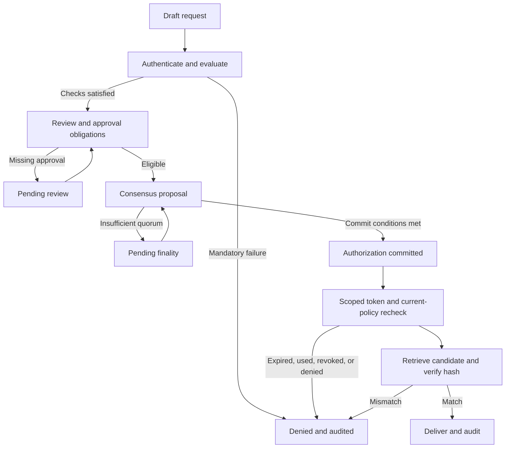
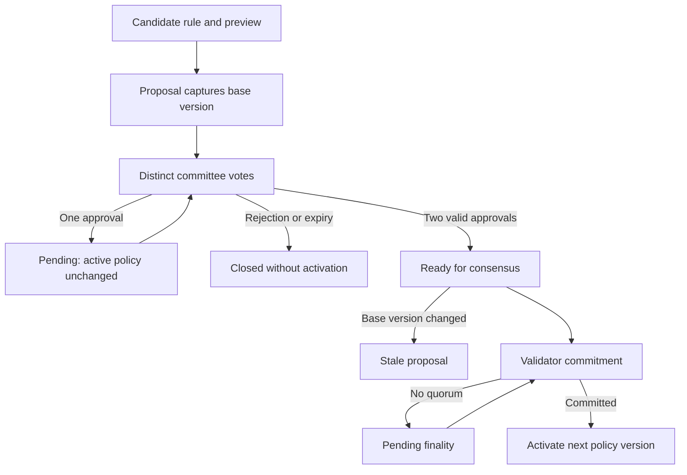

# MediChain architecture and state flow

## Purpose and runtime boundary

MediChain is a browser application for explaining healthcare governance. It uses React and TypeScript, a deterministic local state model, executable policy checks, and browser Web Crypto SHA-256. Vite builds the application as static assets. It has no blockchain node, blockchain RPC, hospital backend, or real patient database.

The Patient and Hospital portals project the same `SimulationState`. The Simulation Theater and execution inspector also read that state, or an explicitly selected historical frame. A change in one portal therefore becomes visible in the other without a separate synchronization service.

The application treats **decision eligibility**, **approval obligations**, **ledger finality**, and **record release** as different stages. A favorable policy result is not sufficient to expose a medical record.

## Five teaching layers

| Layer | Responsibility in the simulator | Boundary |
| --- | --- | --- |
| Application | Patient history requests, hospital queue, governance console, visual teaching controls | Screens are views of shared client-side state; switching portals is an actor-view switch, not authentication |
| Governance contract | Structured identity thresholds, review obligations, clinician conditions, consent applicability, sensitive approvals, and token settings | TypeScript rules model contract behavior; no deployed Solidity or chaincode |
| Identity | Demo DID registry, known key labels, challenge result, credential issuer/status/expiry, assurance evidence | In-memory fixtures model identity; a public-label fingerprint is not a secure signature |
| Ledger and consensus | Four validator objects, phase messages, proposal digests, quorum, metadata-only blocks, previous-hash links, Merkle roots | Local deterministic simulation; no independent replicas or network security |
| Off-chain storage | Fictional clinical records, consent objects, isolated tampered candidates, approved report presentation | Browser memory is a teaching vault, not encrypted production storage |

The available lecture's reference architecture is slide 11 of **Blockchain for Governance Chapter 7.pptx**. Its healthcare storage and permission flow appears on slide 15. The app's five-layer grouping is an instructional organization of those concepts and the assignment requirements; it is not a verbatim slide-number mapping from the unavailable presentation named in the brief.

## Typed domain model

The explicit types in `src/core/types.ts` separate healthcare data from the evidence that may be committed.

| Type | Important data and purpose |
| --- | --- |
| `Patient`, `Credential` | Fictional identity, DID, public key label, issuer, validity, revocation status, assurance level |
| `MedicalRecord` | Patient/hospital references, category, date, classification, clinical content, original content hash, simulated storage reference |
| `AccessRequest` | Requester type, subject patient, record scope, purpose, context, nonce, modeled signature, current status, rule results, approvals, release references |
| `Policy` | Versioned operational configuration; minimum assurance, review requirement, sensitive threshold, clinician conditions, cross-hospital permission, token lifetime |
| `RuleResult` | Rule ID, inputs, expected condition, actual value, result, contribution, explanation, and evaluated policy version |
| `Consent` | Patient, doctor, categories, purpose, expiry, revocation |
| `GovernanceProposal`, `Vote` | Old/new rule value, base version, justification, proposer, expiration, distinct committee votes, consensus state, activation version |
| `Validator`, `ConsensusState` | Availability, modeled rejection/fault behavior, proposal digest, phase, matching participants, messages, and required quorum |
| `LedgerEvent`, `Block` | Pseudonymous references, hashes, decision, policy version, transaction Merkle root, previous block hash, and commitment metadata |
| `CapabilityToken` | Bound request, subject, permitted record IDs, policy version, lifetime, nonce, used/revoked state, and authorization block |
| `AuditEvent` | Actor/event/request references, outcome, explanation, policy version, and explicit local-versus-ledger location |
| `StepDefinition`, `StepExecution` | Stable teaching metadata and the current execution's real inputs/result/state change |
| `HistoryFrame` | A recorded state projection for inspection without re-executing a mutation |

Fictional names and clinical content belong to the portal/vault model. `LedgerEvent` does not contain a patient-name, diagnosis, or medical-summary field. Pseudonymous references and hashes still require privacy review in a real system; they are not automatically anonymous.

## Seeded healthcare context

`src/core/fixtures.ts` initializes three fictional patients: Ayesha Ahmed (`P001`), Omar Malik (`P002`), and Sara Hassan (`P003`). Ten records are distributed across Crescent General Hospital (`H1`) and City Care Medical Center (`H2`). Ayesha has eight, including a lab report, ECG, consultation, prescription, discharge summary, imaging report, sensitive specialist report, and a lab report at the second hospital. The remaining records support ownership-isolation experiments.

The validator roster also contains National Medical Institute (`H3`) and Valley Health Hospital (`H4`). A validator need not be a seeded clinical-data provider in this small dataset.

The initial simulation clock is **5 November 2026, 09:00 UTC / 14:00 PKT**. Time advances through explicit simulation actions so expiry examples do not depend on how quickly a student narrates. Credentials, consents, proposals, and tokens compare against that injected clock.

## Access state flow

The 23 teaching stages refine this flow. They expose request creation, queue arrival, each major check, contract evaluation, consensus phases, commitment, token issue, retrieval, integrity, delivery, and completion. A failed mandatory check branches to denial; it does not continue through decorative success stages.

The denial is enforced immediately and enters local audit. Its metadata-only decision can then follow the proposal, consensus, and commitment stages before final audit. If quorum is unavailable, that denial remains enforced even though its ledger evidence is still pending. A later integrity failure does not erase a previously committed authorization; the two events describe different points in the release process.

For ordinary self-access, the target records must belong to the stated patient. For clinician access, the same subject-to-record match applies, while the clinician also needs the appropriate role and contextual authorization. “Ownership” does not mean that the clinician becomes the owner of a patient's report.

`PENDING` is meaningful. It can mean an unmet manual review or sensitive-record approval obligation. `PENDING_FINALITY` means that the required consensus conditions have not been met. Neither state authorizes the vault to disclose verified content.

## Governance state flow

A preview has no authority. Submitting a proposal does not edit the active policy. Committee approval and validator finality are separate conditions. Activation creates a new version, while old policies and audit entries retain their existing meaning.

A proposal is bound to the version it was created against. If that base has become stale, blindly applying its single-field edit could misrepresent what the committee approved. The simulator rejects stale activation rather than silently rebasing a governance decision.

## Determinism and presentation history

The simulation uses seeded fictional data, explicit scenario identifiers, a simulation clock, and predictable event sequencing. Logical decisions depend on state and inputs, not random votes or arbitrary success probabilities.

Playback controls choose when to execute the next transition. Auto-play is initiated by the user and pauses at decisions that need an actor's input. It is not a background blockchain service.

Historical navigation uses recorded `HistoryFrame` snapshots. It does not undo a committed policy, restore a used token, or re-submit an approval. Moving forward over an already recorded frame presents the same evidence without appending a duplicate block. New real interactions operate against the live state; historical views are for inspection.

Replaying recorded frames and restarting a scenario have different meanings. **Previous Step** and navigation through recorded frames preserve live evidence. **Restart Current Scenario** loads that scenario's clean fixture; **Reset Demo Data** returns to the initial demonstration dataset. Both clean-start operations deliberately begin a new fictional run rather than claiming to delete a real immutable ledger. Export the trace first if the current run is needed for submission.

## Hashes, Merkle trees, and ledger verification

`src/core/crypto.ts` contains the actual cryptographic utility layer:

- `canonical()` recursively sorts object keys and preserves array order to produce stable JSON for this model. It accepts finite JSON-compatible values and rejects circular data and unsupported class instances. This is a project-defined encoding, not a claim of conformance with every JSON canonicalization standard.
- `sha256()` calls Web Crypto and renders the digest as 64 lowercase hexadecimal characters. It fails visibly if Web Crypto is unavailable; it does not substitute a decorative fake hash.
- `hashRecord()` hashes the canonical medical-content object.
- `buildMerkleTree()` takes existing SHA-256 leaf digests and derives parents using a versioned, tagged canonical input. Odd levels duplicate their final digest. Empty trees have an explicit domain-specific hash. This is MediChain's tree format, not Bitcoin's transaction tree or Certificate Transparency's exact encoding.
- `getMerkleProof()` records sibling hashes and their left/right position. `verifyMerkleProof()` recomputes the candidate root from the leaf and proof.
- `createBlock()` computes transaction digests, their Merkle root, the prior hash pointer, and the new block hash.
- `verifyChain()` checks contiguous indices, monotonic simulation timestamps, previous-hash links, transaction Merkle roots, and block digests.

The report-integrity lesson compares a candidate content digest against its seeded anchor. The tamper experiment changes an isolated copy; it does not rewrite the original content or historical block.

There are two deliberately distinct Merkle roots. Each block's `merkleRoot` commits to its **transaction digests**. The four-report teaching tree commits to the **first four seeded report-content hashes**; its root is anchored as `payloadHash` in the genesis `DEMO_REPORT_MERKLE_ANCHOR` transaction. The report-proof experiment compares with that retained report-tree root rather than incorrectly treating it as the block's transaction root.

Hash-chain verification detects inconsistency relative to the retained chain. A user who controls the entire browser could rewrite all data and recompute every hash. Independent trusted checkpoints, signatures, replicas, and operational security would be required to resist that attacker in a real system.

## Audit locations and privacy

Audit records carry a `location` of `LOCAL_AUDIT` or `SIMULATED_LEDGER`. Local checks can be recorded before consensus is available. The UI must not describe those events as committed blocks merely because the check ran.

Consent grants and revocations update the local consent registry and append local audit events. They are not automatically presented as consensus-finalized consent transactions. Access decisions and activated policy changes have explicit consensus/ledger paths. The genesis dataset is labeled as a seeded demonstration trust anchor; no initial network agreement is claimed.

Committed blocks contain limited event metadata. Rule explanations and audit traces should identify the failed condition without copying medical content. Exports are educational evidence from this browser session; they are not signed forensic attestations from an external service.

## Extension points

The separation of typed domain objects, policy evaluation, cryptographic utilities, workflow transitions, and React views makes individual modules replaceable for future research. Replacing a simulation component with a production service would also change the trust boundary and error model. For example, moving the vault to a server requires server-side authorization and storage enforcement; adding a network requires independently verified messages and distributed failure handling. The present client cannot provide those properties by configuration alone.

See `policy-rules.md` for decision semantics, `simulation-limitations.md` for the trust boundary, and `instructor-demo.md` for the classroom walkthrough.
